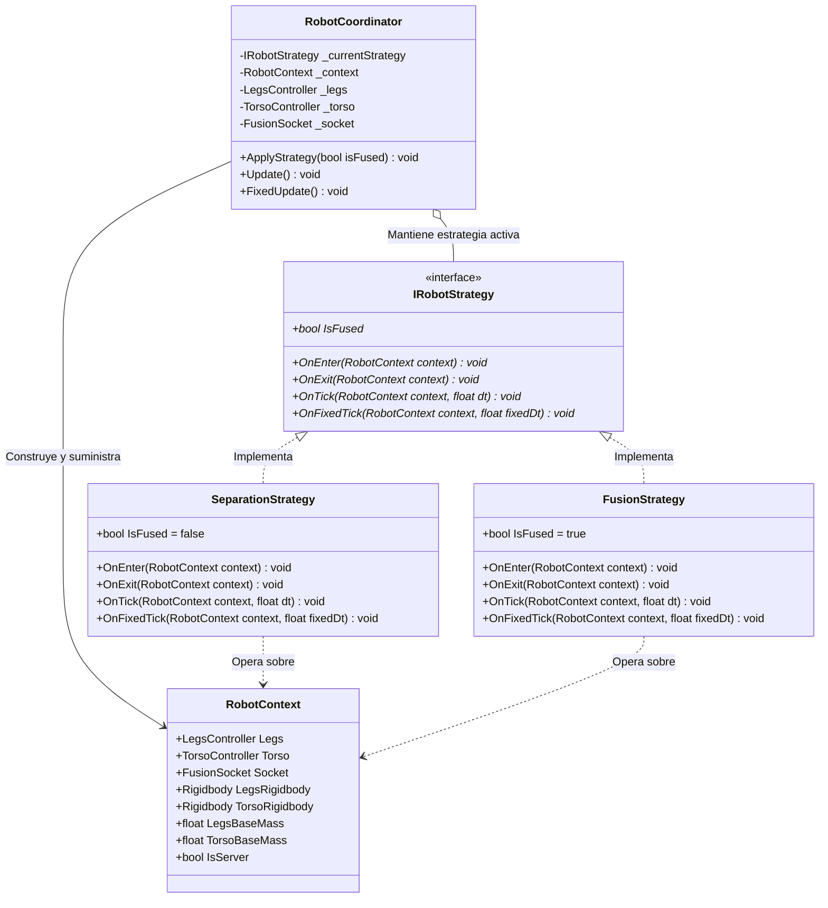
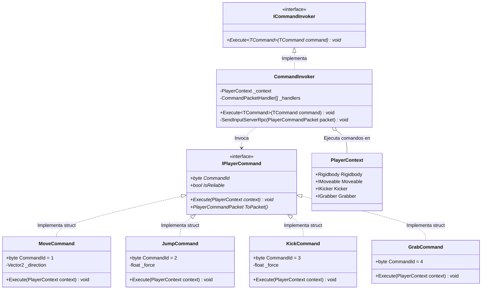
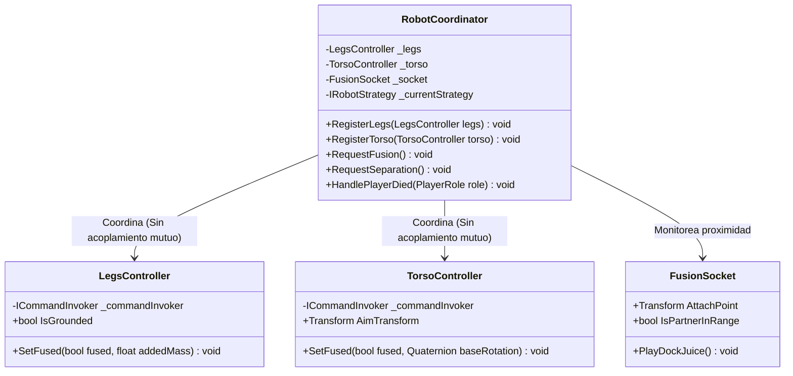
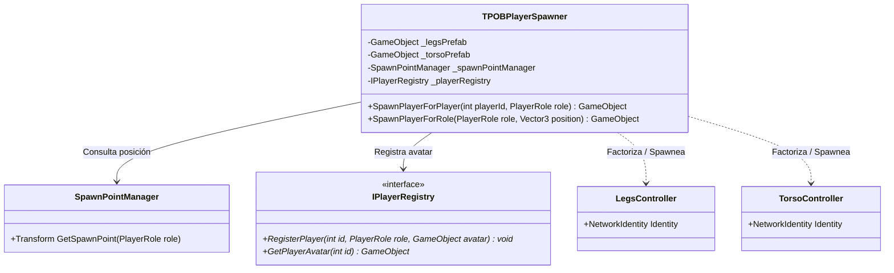
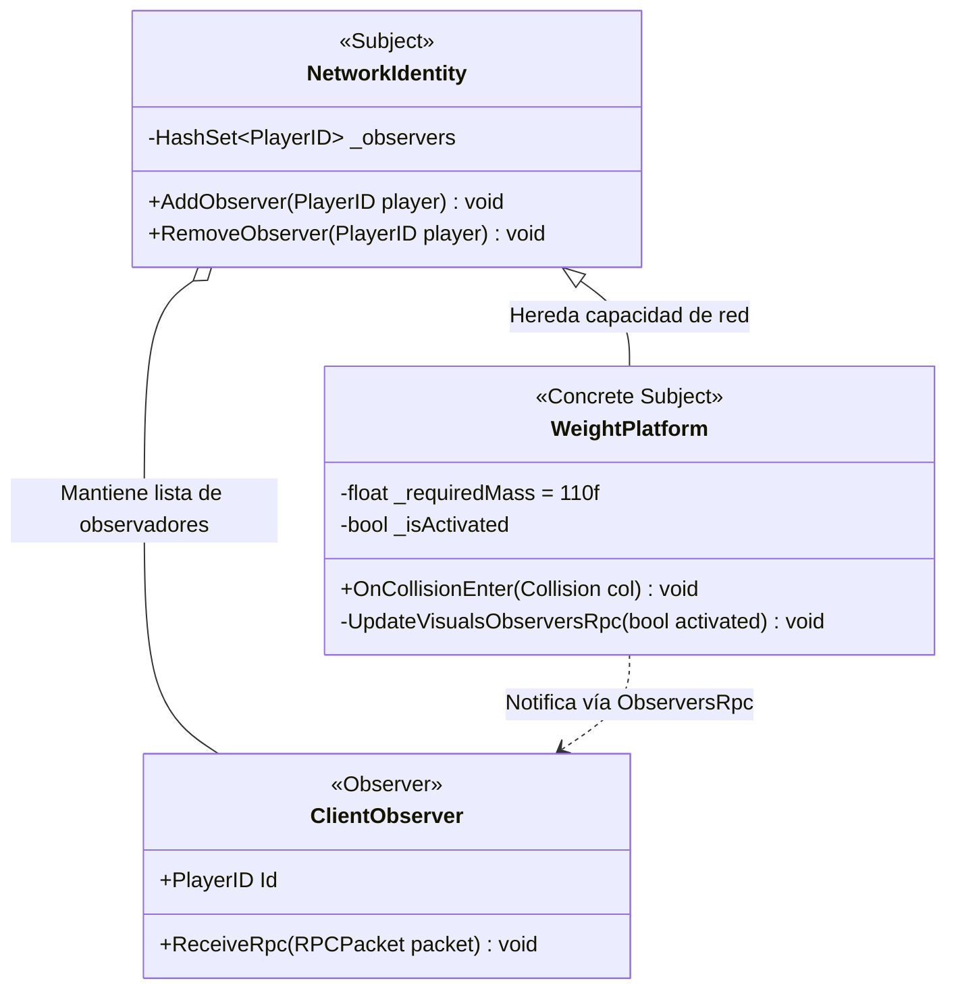
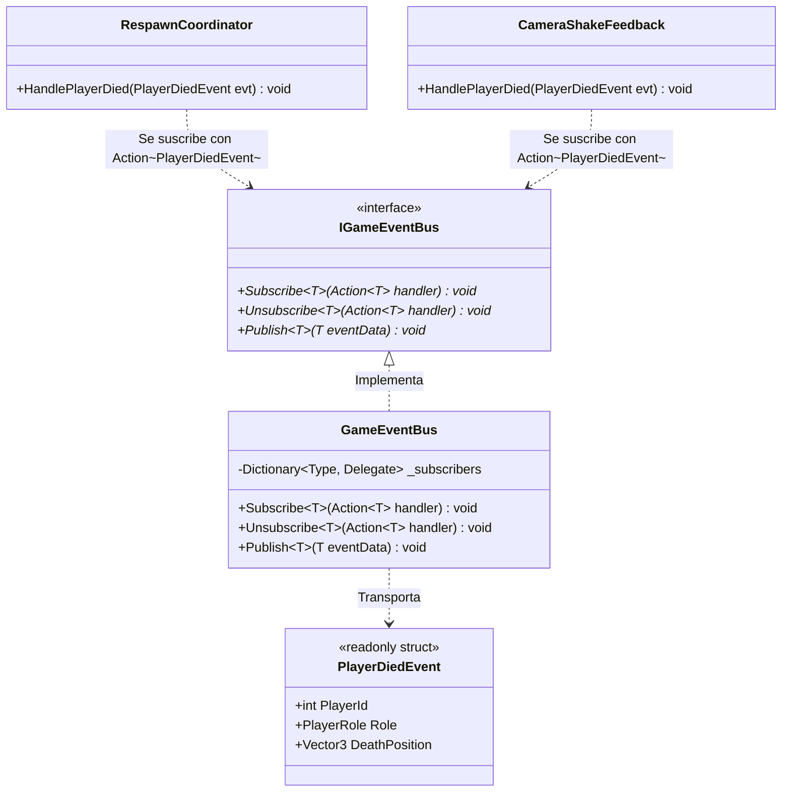
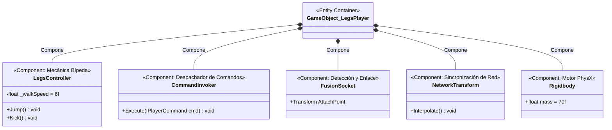
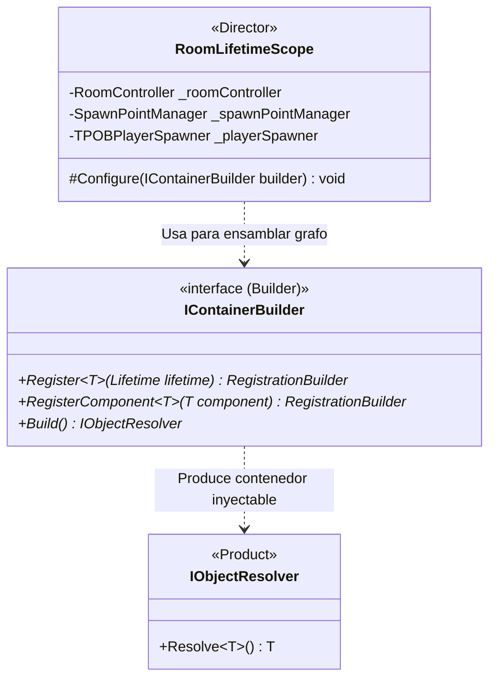

# 🎮 Informe Técnico: Patrones de Diseño en el Gameplay Jugable de TPOB

**Proyecto:** Two Pilots, One Robot (TPOB)  
**Alcance:** Elementos 100% Jugables en Tiempo de Ejecución (Gameplay, Físicas, Red, Personajes y Puzzles)  
**Motor y Lenguaje:** Unity 6000.3.7f1 | C# 9.0 (.NET Standard 2.1)  
**Documento Académico:** Defensa de Arquitectura y Patrones de Software

---

## 📌 Introducción y Enfoque

Este informe descarta deliberadamente herramientas de editor o builders de generación de escenas (considerados soporte de desarrollo) y se enfoca **únicamente en los sistemas jugables en tiempo de ejecución (Runtime Gameplay)**.

El juego aborda un desafío central: **dos jugadores en red física autoritativa controlan cooperativamente mitades complementarias de un mismo robot**, requiriendo alternar entre autonomía individual y acoplamiento motriz unificado. Para lograr esto sin acoplamiento espagueti ni recolección de basura (*Zero-GC*), se implementan los 9 patrones de software aprendidos en clase:

```
┌─────────────────────────────────────────────────────────────────────────────┐
│                           ARQUITECTURA JUGABLE TPOB                         │
├──────────────────────┬───────────────────────────────┬──────────────────────┤
│      CREACIONAL      │          ESTRUCTURAL          │    COMPORTAMIENTO    │
├──────────────────────┼───────────────────────────────┼──────────────────────┤
│ • Factory            │ • Component (Unity ECS-lite)  │ • Strategy           │
│   (Player Spawner)   │   (Entidades del Robot)       │   (Fusión/Separación)│
│ • Builder            │ • Mediator                    │ • Command            │
│   (DI Container /    │   (Robot & Respawn            │   (Acciones Jugador) │
│    Context Builder)  │    Coordinators)              │ • State              │
│                      │                               │   (Salas y Puzzles)  │
│                      │                               │ • Observer Clásico   │
│                      │                               │   (PurrNet RPCs)     │
│                      │                               │ • Observer c/ Action │
│                      │                               │   (GameEventBus)     │
└──────────────────────┴───────────────────────────────┴──────────────────────┘
```

---

## 1. 🦸 Patrón Strategy (Estrategia)

### 🎯 Problema de Gameplay
El robot posee dos modos de juego completamente diferentes:
1. **Modo Separado:** Piernas y Torso caminan por separado como robots independientes (70 kg y 40 kg), cada uno con sus propias velocidades y colisiones.
2. **Modo Fusionado:** El Torso se monta sobre las Piernas. La masa total se unifica a 120 kg, las Piernas controlan toda la traslación del robot y el Torso opera como una torreta giratoria de apuntado e interacción.

Sin el patrón Strategy, los métodos de físicas (`FixedUpdate`) de ambos personajes tendrían condicionales gigantescos `if (isFused)` mezclando lógicas de dos entidades físicas.

### 🏛️ Diagrama de Clases UML (Mermaid)



### 💻 Implementación en Código Jugable

En `FusionStrategy.cs`:
```csharp
public sealed class FusionStrategy : IRobotStrategy
{
    public bool IsFused => true;

    public void OnEnter(RobotContext context)
    {
        // 1. Desactivar colisiones mutuas entre Piernas y Torso
        var torsoColliders = context.Torso.GetComponentsInChildren<Collider>();
        var legsColliders = context.Legs.GetComponentsInChildren<Collider>();
        for (int i = 0; i < torsoColliders.Length; i++)
            for (int j = 0; j < legsColliders.Length; j++)
                Physics.IgnoreCollision(torsoColliders[i], legsColliders[j], true);

        // 2. Bloquear Rigidbody de Torso para que sea transportado por Piernas
        context.TorsoRigidbody.isKinematic = true;
        context.TorsoRigidbody.constraints = RigidbodyConstraints.FreezeAll;

        // 3. Emparentar físicamente al Socket de Piernas
        context.Torso.transform.SetParent(context.Socket.AttachPoint, false);
        context.Torso.transform.localPosition = Vector3.zero;
        context.Torso.transform.localRotation = Quaternion.identity;

        // 4. Configurar estados y recalcular masa combinada (70kg + 40kg = 110kg)
        context.Torso.SetFused(true, context.Legs.transform.rotation);
        context.Legs.SetFused(true, context.TorsoBaseMass);
        context.Socket.PlayDockJuice();
    }
}
```

---

## #️⃣ 2. Patrón Command (Comando)

### 🎯 Problema de Gameplay
Si el lector de teclado/gamepad (`LegsInputReader`) aplicara fuerzas físicas directamente (`rb.AddForce()`), el código estaría rígidamente acoplado al hardware. Esto impediría:
- Enviar paquetes de comandos compactos por la red (`PlayerCommandPacket`).
- Validar autoritativamente en el servidor si la acción es legal antes de ejecutarla.
- Implementar buffers de entrada (*input buffering* para saltos precisos).

### 🏛️ Diagrama de Clases UML (Mermaid)



### 💻 Implementación en Código Jugable

En `JumpCommand.cs`:
```csharp
public readonly struct JumpCommand : IPlayerCommand
{
    public byte CommandId => 2;
    public bool IsReliable => true;
    private readonly float _force;

    public JumpCommand(float force) => _force = force;

    public void Execute(PlayerContext context)
    {
        // Desacoplado: el comando interactúa con el contexto del jugador
        if (context.Moveable != null && context.Moveable.IsGrounded)
        {
            context.Rigidbody.AddForce(Vector3.up * _force, ForceMode.Impulse);
        }
    }

    public PlayerCommandPacket ToPacket() => new PlayerCommandPacket(CommandId, _force, 0f);
}
```

---

## 🚦 3. Patrón Mediator (Mediador)

### 🎯 Problema de Gameplay
En el robot de dos pilotos, `LegsController` y `TorsoController` necesitan coordinarse constantemente:
- Si Torso activa la fusión mientras Piernas está en el aire, debe cancelarse.
- Si Piernas muere por caer a un foso (`KillVolume`), Torso debe enterarse para separarse o morir también.
- Si Piernas salta, Torso debe amortiguar su ángulo.

Si `LegsController` tuviera una referencia a `TorsoController` y viceversa, se crearía una **dependencia circular** caótica y destructiva para el ciclo de vida en red.

### 🏛️ Diagrama de Clases UML (Mermaid)



### 💻 Implementación en Código Jugable

En `RobotCoordinator.cs`:
```csharp
// El mediador recibe la solicitud de una parte y coordina ambas
public void RequestFusion()
{
    if (!CanFuse()) return;

    if (isServer)
    {
        TryFuseOnServer();
    }
    else
    {
        RequestFusionServerRpc();
    }
}

private bool CanFuse()
{
    // El mediador consulta a las partes sin que ellas se conozcan
    return _legs != null && _torso != null && 
           _socket != null && _socket.IsPartnerInRange &&
           !_currentStrategy.IsFused && _legs.IsGrounded;
}
```

---

## 🏭 4. Patrón Factory (Factoría)

### 🎯 Problema de Gameplay
En cada sala de la campaña, cuando un jugador se une o cambia de escena, no se debe hacer un simple `Instantiate()` de Unity:
- Se debe validar qué rol le corresponde al jugador (`Legs` vs `Torso`) según la selección en el lobby.
- Se debe consultar el punto de spawn correspondiente en `SpawnPointManager`.
- Se debe otorgar autoridad de red (`PurrNet Owner`) al socket del jugador conectado.
- Se debe registrar la nueva entidad física en el registro central de jugadores (`IPlayerRegistry`).

### 🏛️ Diagrama de Clases UML (Mermaid)



### 💻 Implementación en Código Jugable

En `TPOBPlayerSpawner.cs`:
```csharp
public GameObject SpawnPlayerForPlayer(int playerId, PlayerRole role)
{
    // 1. Determinar el prefab adecuado según el rol
    GameObject prefabToSpawn = (role == PlayerRole.Legs) ? _legsPrefab : _torsoPrefab;
    
    // 2. Obtener la ubicación autoritativa de inicio
    Transform spawnPoint = _spawnPointManager.GetSpawnPoint(role);
    Vector3 position = spawnPoint != null ? spawnPoint.position : Vector3.zero;

    // 3. Instanciar y configurar red autoritativa
    GameObject instance = Instantiate(prefabToSpawn, position, Quaternion.identity);
    networkManager.Spawn(instance, new PlayerID((byte)playerId));

    // 4. Registrar en el dominio de jugadores
    _playerRegistry.RegisterPlayer(playerId, role, instance);
    return instance;
}
```

---

## 👁️ 5. Patrón Observer Tradicional (Sujeto y Observadores de Red)

### 🎯 Problema de Gameplay
En puzzles multijugador, cuando una placa de presión de 110 kg (`WeightPlatform`) es pisada por el robot, el servidor detecta el cambio físico. Los clientes remotos no deben simular PhysX localmente (para evitar desincronizaciones), pero necesitan enterarse de inmediato para encender luces y reproducir sonido de activación.

### 🏛️ Diagrama de Clases UML (Mermaid)



### 💻 Implementación en Código Jugable

En `WeightPlatform.cs`:
```csharp
// El Sujeto (Servidor) evalúa la condición física de masa
private void CheckActivation()
{
    if (!isServer) return;

    bool shouldActivate = _currentMass >= _requiredMass;
    if (shouldActivate != _isActivated)
    {
        _isActivated = shouldActivate;
        // Notifica a todos los clientes observadores en la red
        UpdateVisualsObserversRpc(_isActivated);
    }
}

[ObserversRpc(runLocally: true, bufferLast: true)]
private void UpdateVisualsObserversRpc(bool activated)
{
    // Cada observador actualiza su vista de forma reactiva
    _indicatorMaterial.color = activated ? _colorActive : _colorInactive;
}
```

---

## 👁️ 6. Patrón Observer mediante Action (C# Idiomático)

### 🎯 Problema de Gameplay
El sistema de Checkpoints y muerte de personajes debe comunicarse con la cámara Cinemachine, el sistema de audio, la UI de respawn y el coordinador de salas sin que ninguno de ellos dependa directamente de los demás.

### 🏛️ Diagrama de Clases UML (Mermaid)



### 💻 Implementación en Código Jugable

En `GameEventBus.cs` y `RespawnCoordinator.cs`:
```csharp
// 1. Suscripción en Awake/Start usando MÉTODO CON NOMBRE (Regla AGY0021)
private void OnEnable()
{
    _eventBus.Subscribe<PlayerDiedEvent>(HandlePlayerDied);
}

private void OnDisable()
{
    _eventBus.Unsubscribe<PlayerDiedEvent>(HandlePlayerDied);
}

// 2. Manejador de evento fuertemente tipado (Cero Boxeo / Zero GC)
private void HandlePlayerDied(PlayerDiedEvent evt)
{
    RespawnPlayerAsync(evt.Role).Forget();
}
```

---

## 🚦 7. Patrón State (Estado)

### 🎯 Problema de Gameplay
Cada sala de pruebas (`Room_01` a `Room_10`) atraviesa un ciclo de vida riguroso:
1. `Inactive`: La sala está cargada pero los jugadores aún están haciendo spawn o sincronizando red.
2. `Active`: Los jugadores están interactuando y resolviendo puzzles físicos.
3. `Completed`: Los mecanismos se cumplieron satisfactoriamente (la compuerta final se desbloquea).
4. `Transitioning`: Ambos jugadores cruzaron la puerta final; se congelan interacciones y se inicia la descarga/carga asíncrona.

Permitir que un puzzle abra puertas mientras la sala está `Inactive` o `Transitioning` generaría condiciones de carrera fatales.

### 🏛️ Diagrama de Clases UML (Mermaid)

```mermaid
stateDiagram-v2
    [*] --> Inactive : Carga de Nivel

    state Inactive {
        description: Spawners posicionando avatares y sincronizando PhysX
    }

    Inactive --> Active : Ambos Jugadores Listos (ActivateRoom)

    state Active {
        description: Gameplay interactivo y evaluación de ICompletionCondition
    }

    Active --> Completed : Puzzle Resuelto (CompleteRoom)

    state Completed {
        description: Compuerta de salida abierta con DOTween
    }

    Completed --> Transitioning : Jugadores pisan ExitTrigger (StartTransition)

    state Transitioning {
        description: LevelManager carga siguiente escena con UniTask
    }

    Transitioning --> [*]
```

### 💻 Implementación en Código Jugable

En `RoomController.cs`:
```csharp
public void SetRoomState(RoomState newState)
{
    if (_currentState == newState) return;
    
    _currentState = newState;

    switch (_currentState)
    {
        case RoomState.Active:
            UnlockMechanisms();
            break;
        case RoomState.Completed:
            _exitDoor.Open();
            _eventBus.Publish(new RoomCompletedEvent(_roomId));
            break;
        case RoomState.Transitioning:
            LockPlayerMovement();
            _levelManager.LoadNextRoomAsync().Forget();
            break;
    }
}
```

---

## 📦 8. Patrón Component (Componente)

### 🎯 Problema de Gameplay
Si modeláramos a los jugadores con herencia tradicional:  
`Entity ➔ NetworkEntity ➔ MoveableEntity ➔ KickableEntity ➔ LegsPlayer`  
Cualquier cambio en la patada afectaría la jerarquía base. Además, el Torso (que no camina pero agarra y dispara imán) compartiría decenas de métodos inútiles de locomoción.

### 🏛️ Diagrama de Clases UML (Mermaid)



> [!TIP]
> **Regla AGY0001 (Shallow Inheritance):** En TPOB está prohibido heredar más de 1 nivel. Las nuevas habilidades se agregan creando un nuevo componente `MonoBehaviour` y acoplándolo al GameObject, nunca extendiendo clases base.

---

## 🧩 9. Patrón Builder (Constructor en Tiempo de Ejecución)

### 🎯 Problema de Gameplay
En cada sala jugable, las dependencias de los sistemas (controlador de sala, sistema de audio, bus de eventos, registros de jugadores y evaluadores de puzzles) deben ensamblarse de forma ordenada y sin referencias estáticas globales (`Singletons`).

### 🛠️ Implementación en Gameplay: `IContainerBuilder` en `RoomLifetimeScope`
Durante la inicialización jugable de cada sala, **VContainer** expone el patrón Builder formal (`IContainerBuilder`). El `RoomLifetimeScope` utiliza este constructor paso a paso para ensamblar el contenedor de dependencias específico de esa sala sin acoplar las clases entre sí:

### 🏛️ Diagrama de Clases UML (Mermaid)



### 💻 Implementación en Código Jugable

En `RoomLifetimeScope.cs`:
```csharp
protected override void Configure(IContainerBuilder builder)
{
    // Construcción paso a paso del grafo de dependencias de la sala
    builder.Register<GameEventBus>(Lifetime.Singleton).As<IGameEventBus>();
    builder.RegisterComponent(_roomController).As<IRoomController>();
    builder.RegisterComponent(_spawnPointManager);
    builder.RegisterComponent(_playerSpawner);
    builder.RegisterComponent(_robotCoordinator);
    
    // Al finalizar Configure(), el builder construye (Build()) el contenedor resuelto
}
```

---

## 📊 Matriz Comparativa para la Exposición

| Patrón                 | Problema de Gameplay que Resuelve en TPOB                                                | ¿Dónde encontrarlo en el proyecto?                  |
| :--------------------- | :--------------------------------------------------------------------------------------- | :-------------------------------------------------- |
| **Strategy**           | Alternar entre física de robot separado (independiente) y fusionado (torreta unificada). | `IRobotStrategy.cs`, `FusionStrategy.cs`            |
| **Command**            | Desacoplar hardware de entrada de PhysX, permitiendo paquetes de red serializables.      | `IPlayerCommand.cs`, `JumpCommand.cs`               |
| **Mediator**           | Coordinar Piernas y Torso sin crear dependencia circular `Legs` ⇄ `Torso`.               | `RobotCoordinator.cs`                               |
| **Factory**            | Spawner de red que resuelve roles, ubica puntos de spawn y otorga ownership.             | `TPOBPlayerSpawner.cs`                              |
| **Observer (Clásico)** | Replicar estados físicos de mecanismos del servidor a clientes en red.                   | `PurrNet [ObserversRpc]`, `WeightPlatform.cs`       |
| **Observer (Action)**  | Comunicación de eventos locales desacoplados con structs inmutables (Zero-GC).           | `GameEventBus.cs`                                   |
| **State**              | Controlar el ciclo de vida ordenado de cada sala (`Inactive` ➔ `Active` ➔ `Completed`).  | `RoomController.cs`, `RoomState.cs`                 |
| **Component**          | Ensamblar habilidades de los robots por composición atómica (Shallow Inheritance).       | `LegsController`, `CapsuleCollider`, `FusionSocket` |
| **Builder**            | Ensamblar el contenedor de dependencias IoC en cada sala en tiempo de ejecución.         | `RoomLifetimeScope.cs` (`IContainerBuilder`)        |
